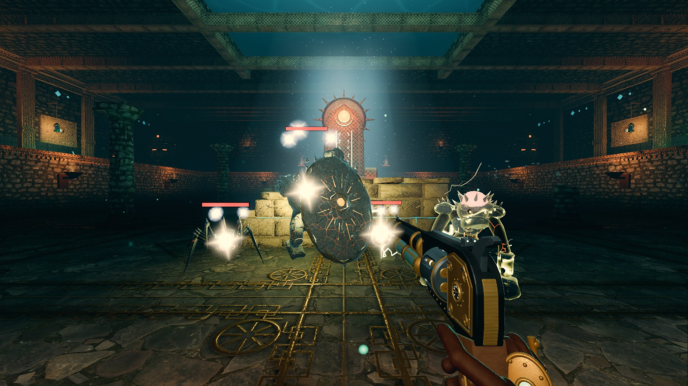
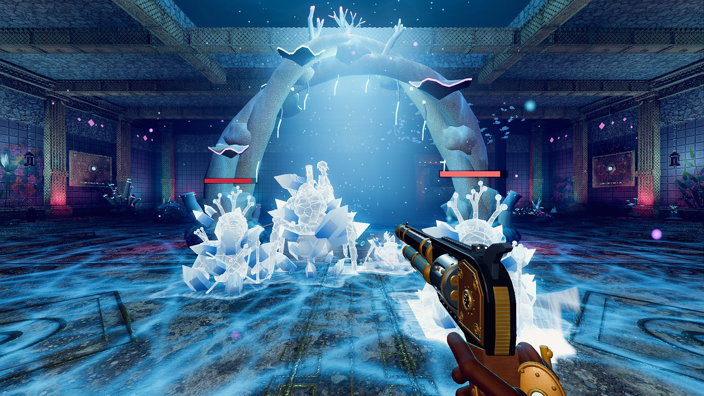
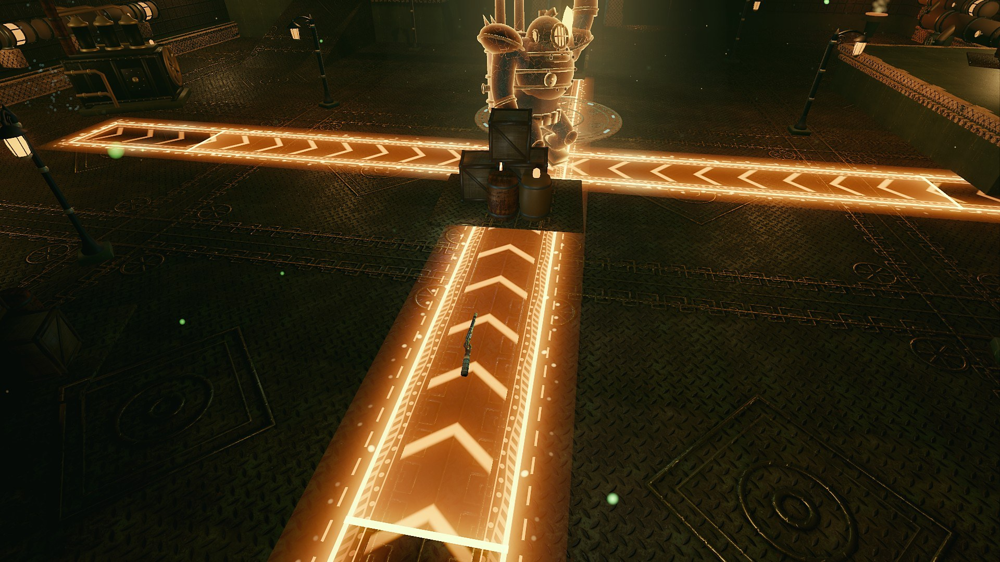
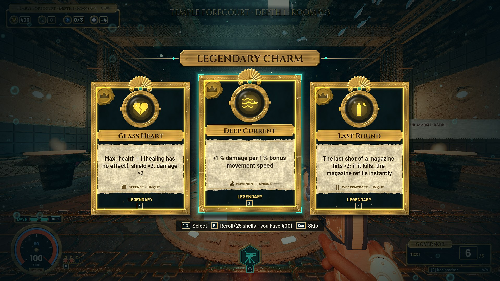
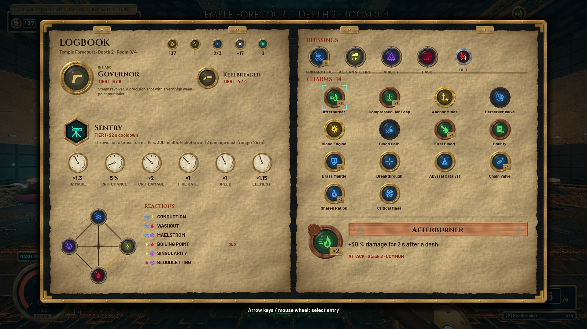
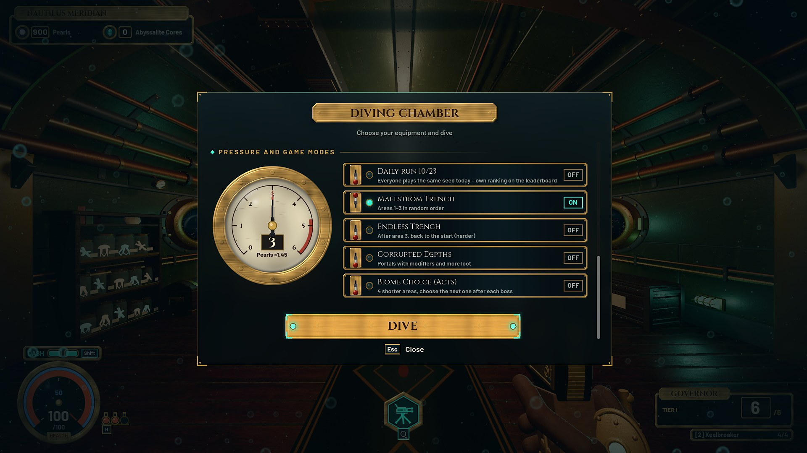
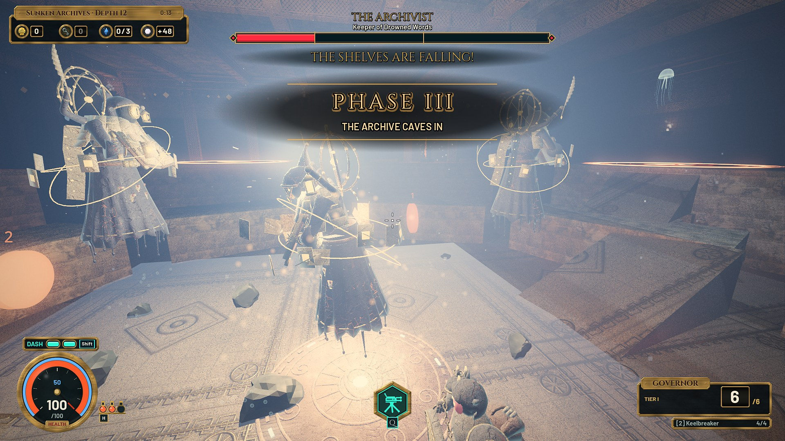
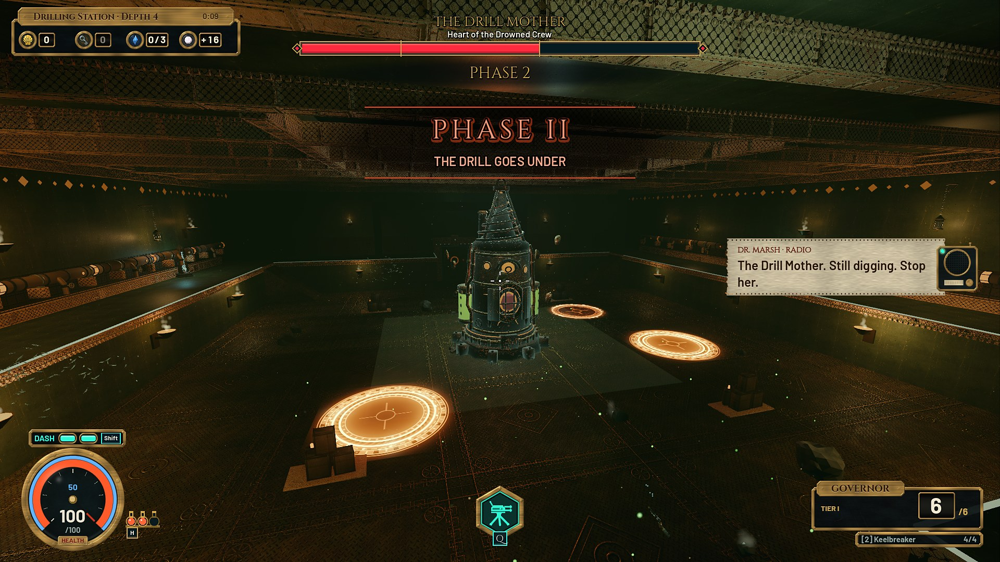
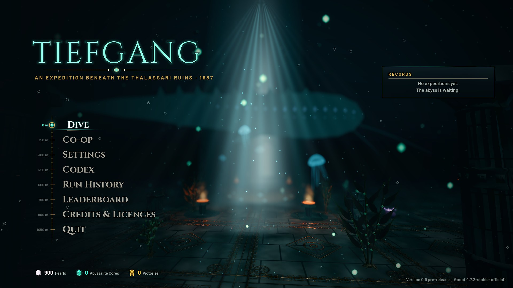

  

  
  
  

  
  

  <a href="README.md"><b>English</b></a> &nbsp;·&nbsp; <b>Deutsch</b> &nbsp;·&nbsp;
  <a href="https://osugerman.github.io/Tiefgang-Releases/"><b>Projektseite</b></a> &nbsp;·&nbsp; <a href="#galerie">Galerie</a> &nbsp;·&nbsp; <a href="CHANGELOG.de.md">Changelog</a>

<!-- TRAILER -->

  
   
  <a href="https://osugerman.github.io/Tiefgang-Releases/#trailer"><b>▶ Cinematic-Trailer ansehen (2:21)</b></a>
  · <a href="docs/media/tiefgang_trailer.mp4">MP4 1080p</a> · <a href="https://github.com/OsuGerman/Tiefgang-Releases/releases/download/v2026.10.13.2110-18d62a60/TIEFGANG_Cinematic_Trailer_4K60.mp4">4K</a>

<!-- /TRAILER -->

> English version of this page: **[README.md](README.md)**

---

**Pazifik, 1887. Unter dem Meeresboden liegen die Ruinen der Thalassari – und das größte Abyssalit-Vorkommen aller Zeiten.**
Steig im Messing-Taucheranzug hinab, kämpf dich Raum für Raum durch leuchtende Ruinen in erdrückender Dunkelheit und bau dir mit jedem Raum einen stärkeren, verrückteren Build. Bis etwas am Grund aufwacht.

### Neu im Test-Build

- **Koop für 1–4 Spieler** – gemeinsam tauchen per Raumcode (meist ohne Portfreigabe), Wiederbeleben, Pings, Live-Schaden der Mitspieler, und jede Angriffswarnung kommt bei allen an.
- **Neuer Look für drei Gebiete** – Tempel, Korallenkathedrale und Versunkene Archive mit gebackenem Licht, Decals und Nebel: tanzende Kaustik, Kerzengold und echter Nebel, und über dem Lichtschacht der Großen Halle zieht ein Leviathan vorbei.
- **Elemente neu gemacht** – gezackter Kettenblitz, ein schwarzes Loch für die Singularität, Frost, der zerspringt, Flutwellen mit Schaumkrone und 6 Duo-Segen mit eigener Optik.
- **25 neue Gegnerangriffe** – Riffkäfige, Siegelstempel, Seitenstürme, Glutgitter, Überdruckkreuze – jeder mit klarer Warnung und einem Fenster zum Ausweichen.
- **Jede Waffe mit eigener Mechanik** – Widerhaken mit dem Walfänger einholen, Haftladungen der Tiefenbombe als Kette zünden, mit der Gezeitenklinge Schüsse als Welle zurückschicken und mehr.
- **Neues Menü, HUD und Logbuch** – Kino-Hauptmenü, Tauchkammer mit Manometer und Hebelschaltern, Messing-HUD, Logbuch (Tab) mit Element-Kompass, genietete Belohnungskarten.
- **Bestenliste, Tageslauf, Biom-Wahl** – Runs zählen automatisch (jederzeit abschaltbar), ein Tagesseed für alle und ein Modus, in dem du nach jedem Akt-Boss das nächste Gebiet wählst.

Alle Änderungen: **[CHANGELOG.de.md](CHANGELOG.de.md)**

### Das Spiel

**TIEFGANG** ist ein schneller Ego-Shooter mit Roguelike-Runs. Jede Expedition führt dich durch 14 Tiefen – Kampfräume, Schatzkammern, Prüfungen und Bossarenen – bis hinunter in den Abgrund. Stillstand ist tödlich: Sprints, Dashes und Doppelsprünge sind deine wichtigste Verteidigung. Zwischen den Tauchgängen kehrst du in dein U-Boot zurück, forschst, rüstest auf und tauchst erneut.

- **5 Gebiete** – Tempelvorhof und Bohrstation als Startgebiete, danach Korallenkathedrale, Versunkene Archive und der Abgrund. Jedes mit eigener Architektur, Atmosphäre, eigenen Gegnern und Gefahren.
- **5 Bosse und 4 Herolde** – Xal-Tuun, die Bohrmutter, Ysmera, der Archivar und das Ohr des Schläfers, dazu ein Herold je Fraktion. Eigene Auftritte, Phasenwechsel, Schwachstellen und Todes-Sequenzen.
- **Fast 50 Gegnerarten** – Steinwächter, Ertrunkene Mannschaft, Korallenbrut und Ertrunkene Schreiber mit Schützen, Flankierern, Schildträgern und Kolossen, dazu Affixe, Elite-Kämpfe und die Laser-Flieger.
- **9 Waffen, 6 Fähigkeiten** – vom Gouverneur über Kielbrecher und Gezeitenklinge bis zur Stimme der Tiefe, jede mit Zweitfeuer, aktivem Nachladen und eigener Mechanik; dazu Wachposten, Phasensprung, Anker-Slam und mehr.
- **95 Charms, 36 Segen** – Charms stapeln und kombinieren sich, Segen bringen die Elemente Flut, Blut, Blitz und Leere samt Reaktionen, dazu 6 Duo-Segen. Absurde Builds sind ausdrücklich erwünscht.
- **Roguelike-Runs mit 14 Tiefen** – jeder Run neu zusammengesetzt, Raum für Raum stärker, Belohnungen nach jeder Arena. Ein voller Tauchgang dauert etwa 25–40 Minuten und lässt sich zwischendurch speichern.
- **U-Boot-Hub** – Werkbank, Forschungstisch, Waffenständer, Reliquienschrein und Kodex.
- **Dr. Marsh am Funk** – über 200 Funksprüche, ein Kodex mit 72 Lore-Einträgen und ein Bestiarium zu jedem Gegner.
- **Deutsch & English** – komplett zweisprachig, live umschaltbar.
- **Koop für 1–4 Spieler** – gemeinsam tauchen per Raumcode (meist ohne Portfreigabe), eigene Charms und Segen, Wiederbeleben, Pings, Live-Schaden der Mitspieler. Anleitung: [KOOP.de.md](KOOP.de.md).

### Download & Installation

1. **[Tiefgang-Windows.zip herunterladen](https://github.com/OsuGerman/Tiefgang-Releases/releases/latest/download/Tiefgang-Windows.zip)** (neuester Test-Build, alle Versionen unter [Releases](https://github.com/OsuGerman/Tiefgang-Releases/releases)).
2. Den Ordner `Tiefgang` dorthin entpacken, wo du schreiben darfst, z. B. Desktop oder Dokumente. **Nicht** nach `C:\Programme`, sonst funktioniert das Auto-Update nicht.
3. `Tiefgang.exe` starten. Meldet Windows „Der Computer wurde durch Windows geschützt“: **Weitere Informationen → Trotzdem ausführen** (der Test-Build ist nicht signiert).

**Auto-Update:** Das Spiel lädt neue Test-Builds automatisch im Hintergrund (abschaltbar unter *Einstellungen → Gameplay*) und installiert sie nur im Hauptmenü, beim Beenden oder beim nächsten Start – nie mitten im Run. **Spielstände bleiben erhalten.** Ohne Internet startet das Spiel ganz normal.

### Systemanforderungen

| | Minimum | Empfohlen |
|---|---|---|
| **Betriebssystem** | Windows 10 (64 Bit) | Windows 10/11 (64 Bit) |
| **Grafik** | Vulkan-fähige Grafikkarte, 4 GB VRAM | Aktuelle Mittelklasse-Grafikkarte, 8 GB VRAM |
| **Prozessor** | 4 Kerne | 6 Kerne oder mehr |
| **Arbeitsspeicher** | 8 GB | 16 GB |
| **Speicherplatz** | ca. 1 GB | ca. 1 GB |
| **Eingabe** | Maus und Tastatur oder Controller | |
| **Sprachen** | Deutsch, Englisch | |

Die Werte sind vorläufig, das Spiel ist in Entwicklung. Internet wird nur für das Auto-Update gebraucht.

### Steuerung

| Aktion | Taste |
|---|---|
| Bewegen / Zielen | `W` `A` `S` `D` / Maus |
| Schießen / Zweitfeuer | Linke / Rechte Maustaste |
| Springen / Dash | `Leertaste` / `Shift` |
| Fähigkeit / Nahkampf | `Q` / `V` |
| Heilen / Benutzen / Nachladen | `H` / `E` / `R` |
| Waffe wechseln | `1` `2` oder Mausrad |
| Waffe ansehen / Charm-Übersicht | `F` / `Tab` |
| Pause | `Esc` |

Controller wird unterstützt. Alle Tasten lassen sich unter **Einstellungen** ändern.

### Feedback geben

Fehler, Abstürze und Eindrücke bitte als **[Issue](https://github.com/OsuGerman/Tiefgang-Releases/issues/new/choose)** melden. Besonders hilfreich:

- **Versionsnummer** (unten rechts im Hauptmenü)
- **Gebiet und Tiefe**, in der es passiert ist
- **Was du getan hast**, was du erwartet hast und was stattdessen passiert ist
- ein **Screenshot** oder kurzes Video, wenn möglich

Auch Eindrücke zum Spielgefühl sind willkommen: Wie fühlen sich Bewegung, Waffen und Bosse an?

---

## Galerie

<table>
  <tr>
    <td width="50%"></td>
    <td width="50%"></td>
  </tr>
  <tr>
    <td></td>
    <td></td>
  </tr>
  <tr>
    <td></td>
    <td></td>
  </tr>
  <tr>
    <td></td>
    <td></td>
  </tr>
  <tr>
    <td></td>
    <td></td>
  </tr>
  <tr>
    <td></td>
    <td></td>
  </tr>
  <tr>
    <td></td>
    <td></td>
  </tr>
  <tr>
    <td></td>
    <td></td>
  </tr>
  <tr>
    <td></td>
    <td></td>
  </tr>
</table>

Weitere Bilder auf der [Projektseite](https://osugerman.github.io/Tiefgang-Releases/). Alle Bilder sind echte Aufnahmen aus dem Test-Build.

## Credits

TIEFGANG wird mit der Godot Engine 4.7 entwickelt. Die vollständigen Namensnennungen liegen als **`CREDITS.md` im Release-Zip** bei.

Fremd-Assets unter CC-BY-Lizenzen:

- Schmerzlaute: „11 male human pain/death sounds“ von **Michel Baradari**, [OpenGameArt](https://opengameart.org/content/11-male-human-paindeath-sounds) – [CC BY 3.0](https://creativecommons.org/licenses/by/3.0/), bearbeitet (gekürzt, gefiltert, gemischt).
- Schweißstrahl: „WWS Welding“ von **Work With Sounds / Technical Museum of Slovenia**, [Wikimedia Commons](https://commons.wikimedia.org/wiki/File:WWS_Welding.ogg) – [CC BY 4.0](https://creativecommons.org/licenses/by/4.0/), bearbeitet (Ausschnitte, gefiltert, gemischt).
- Gesteinsmahlen: „WWS Quern-stones“ von **Work With Sounds / Museum of Municipal Engineering**, [Wikimedia Commons](https://commons.wikimedia.org/wiki/File:WWS_Quern-stones.ogg) – [CC BY 4.0](https://creativecommons.org/licenses/by/4.0/), bearbeitet (verlangsamt, gefiltert, gemischt).

Schriften: Cinzel und Barlow (SIL Open Font License). Musik mit Instrumentenaufnahmen von Sam Gossner / Versilian Studios (VSCO-2-CE, VCSL, CC0). Alle übrigen Fremd-Sounds sind CC0. Ein herzlicher Dank an alle, die ihre Arbeit frei teilen.

Dieses Repository enthält nur die Test-Builds und die Projektseite, nicht den Quellcode.

