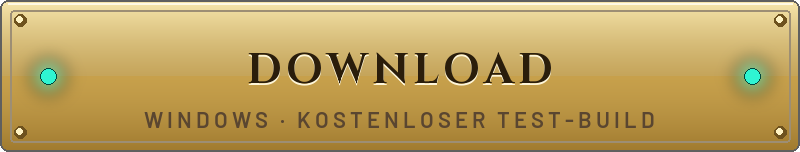
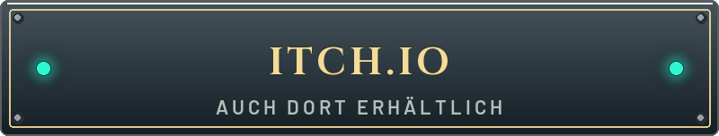
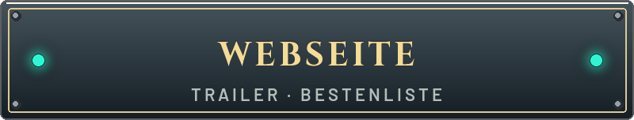
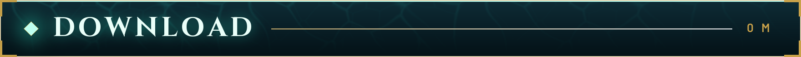
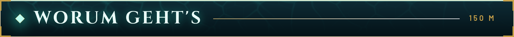
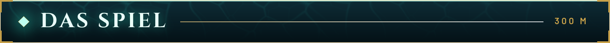
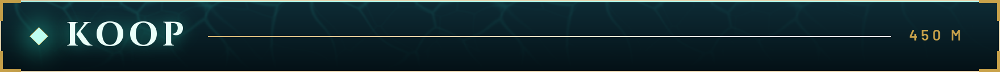
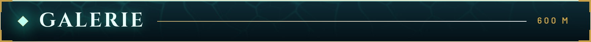
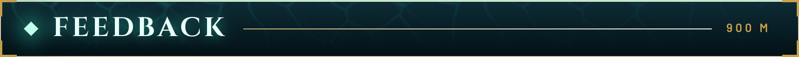
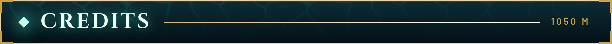

  

  
  
  

  
  
   
  <a href="README.md">English</a> · <b>Deutsch</b> · <a href="CHANGELOG.de.md">Changelog</a> · <a href="KOOP.de.md">Koop-Anleitung</a>

> **FUNK · DR. A. MARSH · PAZIFIK, 1887**
>
> *Tiefgang, hier Marsh. Signal steht. Unter dir liegen die Ruinen der Thalassari, das größte Abyssalit-Vorkommen, das je jemand gefunden hat – und etwas, das schon sehr lange darauf schläft. Tauch runter, bring mit, was du tragen kannst, und wenn du einen Herzschlag hörst, der nicht deiner ist: weiterlaufen.*

  

1. **[Tiefgang-Windows.zip herunterladen](https://github.com/OsuGerman/Tiefgang-Releases/releases/latest/download/Tiefgang-Windows.zip)** – oder über **[itch.io](https://osugerman.itch.io/tiefgang)**. Ältere Builds liegen unter [Releases](https://github.com/OsuGerman/Tiefgang-Releases/releases).
2. Den Ordner `Tiefgang` dorthin entpacken, wo du schreiben darfst (Desktop, Dokumente). Nicht nach `C:\Programme`, sonst kann das Auto-Update nicht arbeiten.
3. `Tiefgang.exe` starten. Windows meldet vermutlich „Der Computer wurde durch Windows geschützt“ – **Weitere Informationen → Trotzdem ausführen**. Der Test-Build ist nicht signiert.

Neue Builds laden sich im Hintergrund und werden nur im Hauptmenü, beim Beenden oder beim nächsten Start installiert – nie mitten im Run. Spielstände bleiben. Kein Internet? Das Spiel startet trotzdem.

<b>Systemanforderungen und Steuerung</b>

| | Minimum | Empfohlen |
|---|---|---|
| System | Windows 10, 64 Bit | Windows 10/11, 64 Bit |
| Grafik | Vulkan-fähig, 4 GB VRAM | Aktuelle Mittelklasse, 8 GB VRAM |
| Prozessor | 4 Kerne | 6 Kerne oder mehr |
| Arbeitsspeicher | 8 GB | 16 GB |
| Speicherplatz | ca. 1 GB | ca. 1 GB |

Vorläufig – das Spiel ist noch in Entwicklung. Maus und Tastatur oder Controller, Deutsch und Englisch.

| Aktion | Taste |
|---|---|
| Bewegen / Zielen | `W` `A` `S` `D` / Maus |
| Schießen / Zweitfeuer | linke / rechte Maustaste |
| Springen / Dash | `Leertaste` / `Shift` |
| Fähigkeit / Nahkampf | `Q` / `V` |
| Heilen / Benutzen / Nachladen | `H` / `E` / `R` |
| Waffe wechseln | `1` `2` oder Mausrad |
| Waffe ansehen / Charms | `F` / `Tab` |
| Pause | `Esc` |

Alle Tasten lassen sich in den Einstellungen ändern.

Ein schneller Ego-Shooter mit Roguelike-Runs. Du tauchst durch **14 Tiefen** aus Kampfräumen, Schatzkammern, Prüfungen und Bossarenen, sammelst nach jedem Kampf Charms und Segen, bis dein Build entweder unaufhaltsam oder sehr, sehr lustig ist. Stehenbleiben ist tödlich; Sprint, Dash und Doppelsprung sind deine eigentliche Rüstung. Zwischen den Tauchgängen geht’s zurück ins U-Boot: forschen, ausrüsten, wieder runter – eine Druckstufe tiefer.

Ein Indie-Projekt in aktiver Entwicklung. Es ändert sich schnell, und vieles hier gibt es nur, weil Tester sich über etwas beschwert haben. Zuletzt dazugekommen: Koop für bis zu vier, drei Gebiete im neuen Grafik-Standard, neu gemachte Element-Effekte, 25 neue Gegnerangriffe und eine eigene Mechanik für jede Waffe. Alles Weitere steht im **[Changelog](CHANGELOG.de.md)**.

<!-- TRAILER -->

  
   
  <a href="https://osugerman.github.io/Tiefgang-Releases/#trailer"><b>▶ Cinematic-Trailer ansehen (2:21)</b></a>
  · <a href="docs/media/tiefgang_trailer.mp4">MP4 1080p</a> · <a href="https://github.com/OsuGerman/Tiefgang-Releases/releases/download/v2026.10.13.2110-18d62a60/TIEFGANG_Cinematic_Trailer_4K60.mp4">4K</a>

<!-- /TRAILER -->

<table>
  <tr>
    <td width="50%"><b>5 Gebiete, 14 Tiefen</b> Tempelvorhof oder Bohrstation, danach Korallenkathedrale, Versunkene Archive und der Abgrund.</td>
    <td width="50%"><b>5 Bosse, 4 Herolde</b> Xal-Tuun, die Bohrmutter, Ysmera, der Archivar, das Ohr des Schläfers – Phasen, Schwachstellen, eigene Musik.</td>
  </tr>
  <tr>
    <td><b>9 Waffen, 6 Fähigkeiten</b> Jede Waffe mit Zweitfeuer, aktivem Nachladen und eigenem Trick. Der Walfänger zieht Gegner an Widerhaken heran.</td>
    <td><b>95 Charms, 36 Segen + 6 Duo</b> Flut, Blut, Blitz und Leere mit Reaktionen. Fühlt sich dein Build illegal an, machst du alles richtig.</td>
  </tr>
  <tr>
    <td><b>10 Druckstufen</b> Den Abgrund geschafft? Dann dreh am Manometer. Dazu Tageslauf und Biom-Wahl.</td>
    <td><b>Dr. Marsh am Funk</b> Über 200 Funksprüche, 72 Kodex-Einträge und ein Bestiarium für alles, was dich fressen will.</td>
  </tr>
</table>

  

Bis zu **vier Taucher**. Einer hostet, die anderen tippen einen Raumcode ein – übers Internet klappt das meist ohne Portfreigabe, im Heimnetz gibt es zusätzlich einen LAN-Code. Jeder wählt eigene Charms und Segen, Muscheln werden geteilt, und wer am Boden liegt, kann wiederbelebt werden. Schritt für Schritt: **[KOOP.de.md](KOOP.de.md)**.

<table>
  <tr>
    <td width="33%"></td>
    <td width="33%"></td>
    <td width="33%"></td>
  </tr>
  <tr>
    <td></td>
    <td></td>
    <td></td>
  </tr>
  <tr>
    <td></td>
    <td></td>
    <td></td>
  </tr>
</table>

Alles echte Aufnahmen aus dem Test-Build. Mehr auf der **[Webseite](https://osugerman.github.io/Tiefgang-Releases/)**.

Fehler gefunden, Absturz erlebt oder findest du, der Dash fühlt sich matschig an? **[Issue aufmachen](https://github.com/OsuGerman/Tiefgang-Releases/issues/new/choose)** – Deutsch oder Englisch. Versionsnummer (unten rechts im Hauptmenü), Gebiet, Tiefe und ein Screenshot helfen sehr. Ehrliches Feedback hat Teile dieses Spiels schon mehrmals umgebaut.

Entwickelt mit der Godot Engine 4.7. Vollständige Namensnennungen liegen als `CREDITS.md` im Release-Zip.

- Schmerzlaute: „11 male human pain/death sounds“ von **Michel Baradari**, [OpenGameArt](https://opengameart.org/content/11-male-human-paindeath-sounds) – [CC BY 3.0](https://creativecommons.org/licenses/by/3.0/), bearbeitet.
- Schweißstrahl: „WWS Welding“ von **Work With Sounds / Technical Museum of Slovenia**, [Wikimedia Commons](https://commons.wikimedia.org/wiki/File:WWS_Welding.ogg) – [CC BY 4.0](https://creativecommons.org/licenses/by/4.0/), bearbeitet.
- Mahlstein: „WWS Quern-stones“ von **Work With Sounds / Museum of Municipal Engineering**, [Wikimedia Commons](https://commons.wikimedia.org/wiki/File:WWS_Quern-stones.ogg) – [CC BY 4.0](https://creativecommons.org/licenses/by/4.0/), bearbeitet.
- Trailer-Musik: „Devastation and Revenge“ von **Kevin MacLeod**, [incompetech.com](https://incompetech.com) – [CC BY 4.0](https://creativecommons.org/licenses/by/4.0/).

Schriften Cinzel und Barlow (SIL Open Font License). Musik mit Instrumentaufnahmen von Sam Gossner / Versilian Studios (VSCO-2-CE, VCSL, CC0). Alle übrigen fremden Klänge sind CC0. Danke an alle, die ihre Arbeit frei teilen.

Dieses Repository enthält die Test-Builds und die Webseite, nicht den Quellcode.

