

  

  
  
  

  <a href="https://osugerman.github.io/Tiefgang-Releases/">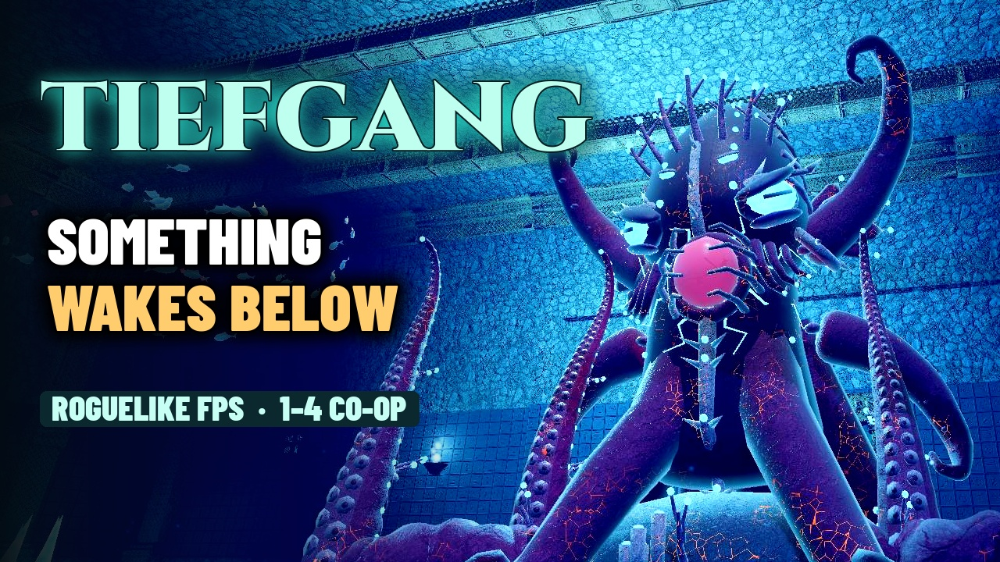</a>
  <a href="https://osugerman.github.io/Tiefgang-Releases/">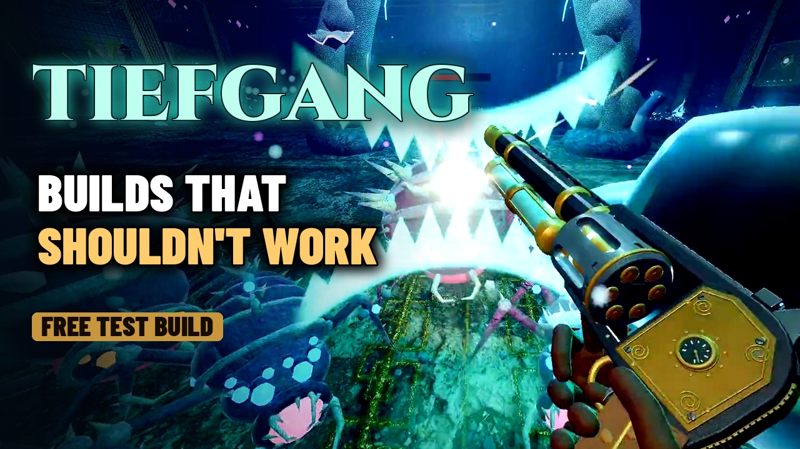</a>

  <a href="#deutsch"><b>Deutsch</b></a> &nbsp;·&nbsp; <a href="#english"><b>English</b></a> &nbsp;·&nbsp;
  <a href="https://osugerman.github.io/Tiefgang-Releases/"><b>Projektseite · Website</b></a> &nbsp;·&nbsp;
  <a href="#galerie--gallery">Galerie · Gallery</a>

<!-- TRAILER -->

  
   
  <a href="https://osugerman.github.io/Tiefgang-Releases/#trailer"><b>▶ Cinematic-Trailer ansehen · Watch the cinematic trailer (2:21)</b></a>
  · <a href="docs/media/tiefgang_trailer.mp4">MP4 1080p</a> · <a href="https://github.com/OsuGerman/Tiefgang-Releases/releases/download/v2026.10.13.2110-18d62a60/TIEFGANG_Cinematic_Trailer_4K60.mp4">4K</a>

<!-- /TRAILER -->

---

## Deutsch

**Pazifik, 1887. Unter dem Meeresboden liegen die Ruinen der Thalassari – und das größte Abyssalit-Vorkommen aller Zeiten.**
Steig im Messing-Taucheranzug hinab, kämpf dich Raum für Raum durch leuchtende Ruinen in erdrückender Dunkelheit und bau dir mit jedem Raum einen stärkeren, verrückteren Build. Bis etwas am Grund aufwacht.

### Neu im Test-Build

- **Jetzt auf Englisch** – das ganze Spiel ist übersetzt: Menüs, HUD, Waffen, Charms, Gegner, Funksprüche von Dr. Marsh und der Kodex. Umschalten unter *Einstellungen → Gameplay → „Sprache · Language“*, sofort und ohne Neustart.
- **Gouverneur: Nachladen neu** – die Hand greift wirklich zu: Riegel, Trommel schwingt im Dampf aus, Hülsen fliegen, Schnelllader rein und drehen, Trommel zu. Perfekt getroffen schnappt sie von selbst zu.
- **Visier-Riss** – bricht der Schild, springt das Helmglas sternförmig von der Trefferseite; der Riss verheilt türkis, sobald der Schild lädt. Abschaltbar unter Barrierefreiheit.
- **4 Laser-Flieger** ab der 3. Tiefe jedes Gebiets (Brennglasmotte, Schneiddrohne, Strahlqualle, Brennseite) – Ziellinie, Einrasten, Blinken, Strahl. Ein Seitenschritt rettet dich.
- **Klang und Bossmusik** – Metallrumpf im U-Boot, dumpf unter Wasser, die Kammer flutet hörbar; Bossmusik wird mit jeder Phase dichter und hat unter 15 % Boss-Leben ihren Höhepunkt.
- **Run speichern** – „Speichern & Beenden“ im Pausemenü, „Run fortsetzen“ im Hauptmenü, dazu die Run-Übersicht deiner letzten 30 Runs.

Alle Änderungen: **[CHANGELOG.md](CHANGELOG.md)**

### Das Spiel

**TIEFGANG** ist ein schneller Ego-Shooter mit Roguelike-Runs. Jede Expedition führt dich durch 14 Tiefen – Kampfräume, Schatzkammern, Prüfungen und Bossarenen – bis hinunter in den Abgrund. Stillstand ist tödlich: Sprints, Dashes und Doppelsprünge sind deine wichtigste Verteidigung. Zwischen den Tauchgängen kehrst du in dein U-Boot zurück, forschst, rüstest auf und tauchst erneut.

- **5 Gebiete** – Tempelvorhof und Bohrstation als Startgebiete, danach Korallenkathedrale, Versunkene Archive und der Abgrund. Jedes mit eigener Architektur, Atmosphäre, eigenen Gegnern und Gefahren.
- **5 Bosse und 4 Herolde** – Xal-Tuun, die Bohrmutter, Ysmera, der Archivar und das Ohr des Schläfers, dazu ein Herold je Fraktion. Eigene Auftritte, Phasenwechsel, Schwachstellen und Todes-Sequenzen.
- **Fast 50 Gegnerarten** – Steinwächter, Ertrunkene Mannschaft, Korallenbrut und Ertrunkene Schreiber mit Schützen, Flankierern, Schildträgern und Kolossen, dazu Affixe, Elite-Kämpfe und die Laser-Flieger.
- **9 Waffen, 6 Fähigkeiten** – vom Gouverneur über Kielbrecher und Gezeitenklinge bis zur Stimme der Tiefe, jede mit Zweitfeuer und aktivem Nachladen; dazu Wachposten, Phasensprung, Anker-Slam und mehr.
- **55 Charms, 21 Segen** – Charms stapeln und kombinieren sich, Segen bringen die Elemente Flut, Blut, Blitz und Leere samt Reaktionen. Absurde Builds sind ausdrücklich erwünscht.
- **Roguelike-Runs mit 14 Tiefen** – jeder Run neu zusammengesetzt, Raum für Raum stärker, Belohnungen nach jeder Arena. Ein voller Tauchgang dauert etwa 25–40 Minuten und lässt sich zwischendurch speichern.
- **U-Boot-Hub** – Werkbank, Forschungstisch, Waffenständer, Reliquienschrein und Kodex.
- **Dr. Marsh am Funk** – über 200 Funksprüche, ein Kodex mit 72 Lore-Einträgen und ein Bestiarium zu jedem Gegner.
- **Deutsch & English** – komplett zweisprachig, live umschaltbar.
- **Koop für 1–4 Spieler** – gemeinsam tauchen per Raumcode (meist ohne Portfreigabe), eigene Charms und Segen, Wiederbeleben, Pings, Live-Schaden der Mitspieler. Anleitung: [KOOP.md](KOOP.md).

### Download & Installation

1. **[Tiefgang-Windows.zip herunterladen](https://github.com/OsuGerman/Tiefgang-Releases/releases/latest/download/Tiefgang-Windows.zip)** (neuester Test-Build, alle Versionen unter [Releases](https://github.com/OsuGerman/Tiefgang-Releases/releases)).
2. Den Ordner `Tiefgang` dorthin entpacken, wo du schreiben darfst, z. B. Desktop oder Dokumente. **Nicht** nach `C:\Programme`, sonst funktioniert das Auto-Update nicht.
3. `Tiefgang.exe` starten. Meldet Windows „Der Computer wurde durch Windows geschützt“: **Weitere Informationen → Trotzdem ausführen** (der Test-Build ist nicht signiert).

**Auto-Update:** Das Spiel lädt neue Test-Builds automatisch im Hintergrund (abschaltbar unter *Einstellungen → Gameplay*) und installiert sie nur im Hauptmenü, beim Beenden oder beim nächsten Start – nie mitten im Run. **Spielstände bleiben erhalten.** Ohne Internet startet das Spiel ganz normal.

### Systemanforderungen

| | Minimum | Empfohlen |
|---|---|---|
| **Betriebssystem** | Windows 10 (64 Bit) | Windows 10/11 (64 Bit) |
| **Grafik** | Vulkan-fähige Grafikkarte, 4 GB VRAM | Aktuelle Mittelklasse-Grafikkarte, 8 GB VRAM |
| **Prozessor** | 4 Kerne | 6 Kerne oder mehr |
| **Arbeitsspeicher** | 8 GB | 16 GB |
| **Speicherplatz** | ca. 1 GB | ca. 1 GB |
| **Eingabe** | Maus und Tastatur oder Controller | |
| **Sprachen** | Deutsch, Englisch | |

Die Werte sind vorläufig, das Spiel ist in Entwicklung. Internet wird nur für das Auto-Update gebraucht.

### Steuerung

| Aktion | Taste |
|---|---|
| Bewegen / Zielen | `W` `A` `S` `D` / Maus |
| Schießen / Zweitfeuer | Linke / Rechte Maustaste |
| Springen / Dash | `Leertaste` / `Shift` |
| Fähigkeit / Nahkampf | `Q` / `V` |
| Heilen / Benutzen / Nachladen | `H` / `E` / `R` |
| Waffe wechseln | `1` `2` oder Mausrad |
| Waffe ansehen / Charm-Übersicht | `F` / `Tab` |
| Pause | `Esc` |

Controller wird unterstützt. Alle Tasten lassen sich unter **Einstellungen** ändern.

### Feedback geben

Fehler, Abstürze und Eindrücke bitte als **[Issue](https://github.com/OsuGerman/Tiefgang-Releases/issues/new/choose)** melden. Besonders hilfreich:

- **Versionsnummer** (unten rechts im Hauptmenü)
- **Gebiet und Tiefe**, in der es passiert ist
- **Was du getan hast**, was du erwartet hast und was stattdessen passiert ist
- ein **Screenshot** oder kurzes Video, wenn möglich

Auch Eindrücke zum Spielgefühl sind willkommen: Wie fühlen sich Bewegung, Waffen und Bosse an?

---

## English

**The Pacific, 1887. Beneath the seabed lie the ruins of the Thalassari – and the richest Abyssalite deposit ever found.**
Descend in a brass diving suit, fight your way room by room through glowing ruins in crushing darkness, and grow a stronger, stranger build with every room. Until something at the bottom wakes up.

### What’s new in the test build

- **Now in English** – the whole game is translated: menus, HUD, weapons, charms, enemies, Dr. Marsh’s radio messages and the Codex. Switch under *Settings → Gameplay → “Sprache · Language”*, instantly and without a restart.
- **Governor: a new reload** – the hand really works the gun: latch, the cylinder swings out in a puff of steam, casings fly, speedloader in and twist, cylinder shut. Nail the perfect reload and it snaps shut on its own.
- **Visor cracks** – when your shield breaks, the helmet glass stars outward from the side you were hit; the crack heals turquoise as the shield recharges. Can be turned off under Accessibility.
- **4 laser fliers** from the third depth of every area (Burning-Glass Moth, Cutter Drone, Lantern Jelly, Burning Page) – targeting line, lock-on, flash, beam. One sidestep saves you.
- **Sound and boss music** – a ringing metal hull in the submarine, muffled sound underwater, an audibly flooding dive chamber; boss music thickens with every phase and peaks below 15 % of the boss’s health.
- **Save your run** – “Save & Quit” in the pause menu, “Resume Run” in the main menu, plus a Run History of your last 30 runs.

All changes: **[CHANGELOG.md](CHANGELOG.md)** (mostly German).

### The game

**TIEFGANG** is a fast first-person shooter built around roguelike runs. Every expedition takes you down through 14 depths – combat rooms, treasure vaults, trials and boss arenas – all the way into the Abyss. Standing still is fatal: sprints, dashes and double jumps are your best defence. Between dives you return to your submarine to research, gear up and go back down.

- **5 areas** – the Temple Forecourt and the Drilling Station as starting areas, then the Coral Cathedral, the Sunken Archives and the Abyss, each with its own architecture, atmosphere, enemies and hazards.
- **5 bosses and 4 Heralds** – Xal-Tuun, the Drill Mother, Ysmera, the Archivist and the Sleeper’s Ear, plus a Herald for every faction. Each with its own entrance, phase changes, weak points and death sequence.
- **Nearly 50 enemy types** – Stone Wardens, Drowned Crew, Coral Brood and Drowned Scribes field marksmen, flankers, shield-bearers and colossi, plus affixes, elite fights and the laser fliers.
- **9 weapons, 6 abilities** – from the Governor via the Keelbreaker and the Tide Blade to the Voice of the Deep, each with an alt-fire and active reload; plus Sentry, Phase Jump, Anchor Slam and more.
- **55 charms, 21 blessings** – charms stack and combine; blessings bring the elements Tide, Blood, Lightning and Void, complete with reactions. Absurd builds are actively encouraged.
- **Roguelike runs, 14 depths** – every run assembled anew, stronger room by room, rewards after every arena. A full dive takes about 25–40 minutes, and you can save and resume along the way.
- **Submarine hub** – Workbench, Research Desk, Weapon Rack, Reliquary Shrine and Codex Shelf.
- **Dr. Marsh on the radio** – more than 200 radio lines, a Codex of 72 lore entries and a Bestiary entry for every enemy.
- **English & Deutsch** – fully bilingual, switchable live.
- **Co-op for 1–4 players** – dive together via room code (usually no port forwarding), your own charms and blessings, revives, pings, live teammate damage. Guide: [KOOP.md](KOOP.md).

### Download and install

1. **[Download Tiefgang-Windows.zip](https://github.com/OsuGerman/Tiefgang-Releases/releases/latest/download/Tiefgang-Windows.zip)** (latest test build; every version is under [Releases](https://github.com/OsuGerman/Tiefgang-Releases/releases)).
2. Extract the `Tiefgang` folder somewhere you can write to, such as Desktop or Documents. **Not** into `C:\Program Files`, or the auto-update won’t work.
3. Run `Tiefgang.exe`. If Windows says “Windows protected your PC”: **More info → Run anyway** (the test build is not signed).

**Auto-update:** the game downloads new test builds automatically in the background (can be turned off under *Settings → Gameplay*) and installs them only in the main menu, on quitting or at the next start – never mid-run. **Your saves are kept.** Without an internet connection the game simply starts as usual.

### System requirements

| | Minimum | Recommended |
|---|---|---|
| **OS** | Windows 10 (64-bit) | Windows 10/11 (64-bit) |
| **Graphics** | Vulkan-capable GPU, 4 GB VRAM | Current mid-range GPU, 8 GB VRAM |
| **Processor** | 4 cores | 6 cores or more |
| **Memory** | 8 GB | 16 GB |
| **Storage** | approx. 1 GB | approx. 1 GB |
| **Input** | Mouse and keyboard or controller | |
| **Languages** | English, German | |

Provisional figures – the game is in development. The internet is only needed for the auto-update.

### Controls

| Action | Key |
|---|---|
| Move / Aim | `W` `A` `S` `D` / Mouse |
| Fire / Alt-fire | Left / Right mouse button |
| Jump / Dash | `Space` / `Shift` |
| Ability / Melee | `Q` / `V` |
| Heal / Use / Reload | `H` / `E` / `R` |
| Switch weapon | `1` `2` or mouse wheel |
| Inspect weapon / Charms | `F` / `Tab` |
| Pause | `Esc` |

Controllers are supported. Every key can be rebound under **Settings**.

### Feedback

Please report bugs, crashes and impressions as an **[issue](https://github.com/OsuGerman/Tiefgang-Releases/issues/new/choose)** – in English or German. Most helpful:

- the **version number** (bottom right of the main menu)
- the **area and depth** where it happened
- **what you did**, what you expected and what happened instead
- a **screenshot** or short video, if you can

Thoughts on how it plays are welcome too: how do movement, weapons and bosses feel?

---

## Galerie · Gallery

<table>
  <tr>
    <td width="50%"><a href="media/neu_xaltuun_tod.jpg">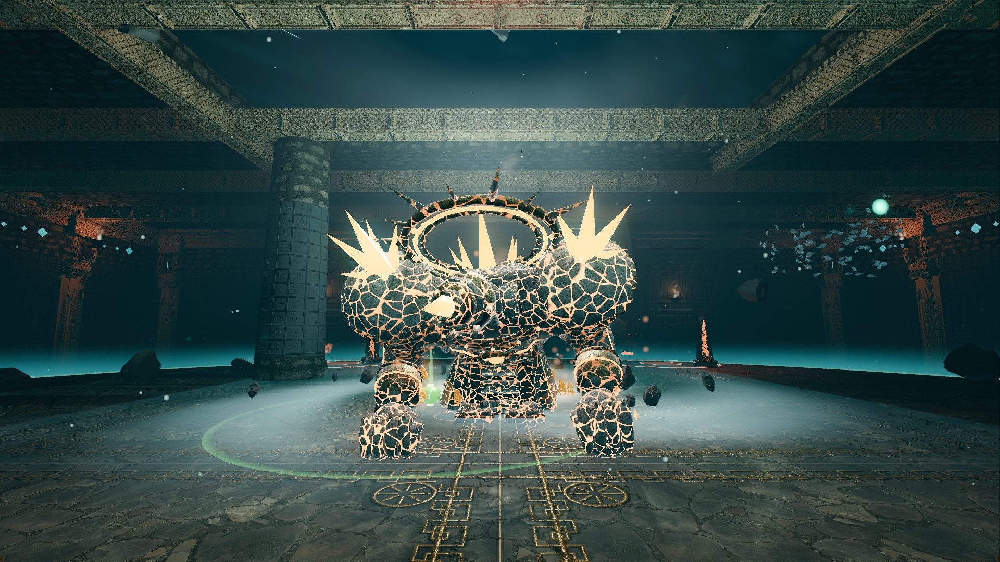</a></td>
    <td width="50%"><a href="media/boss_ysmera.jpg">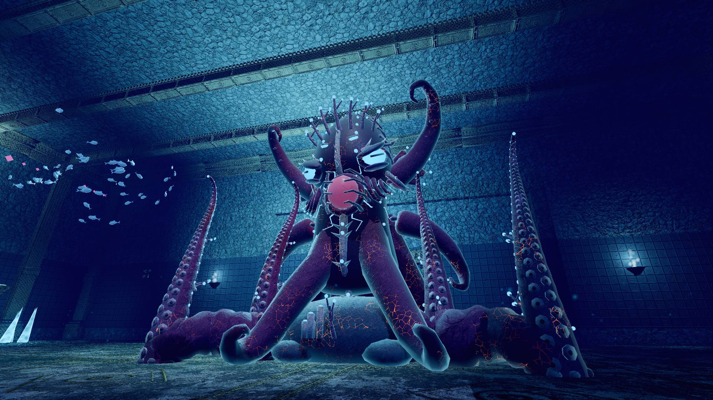</a></td>
  </tr>
  <tr>
    <td><a href="media/neu_archiv_himmelsglobus.jpg">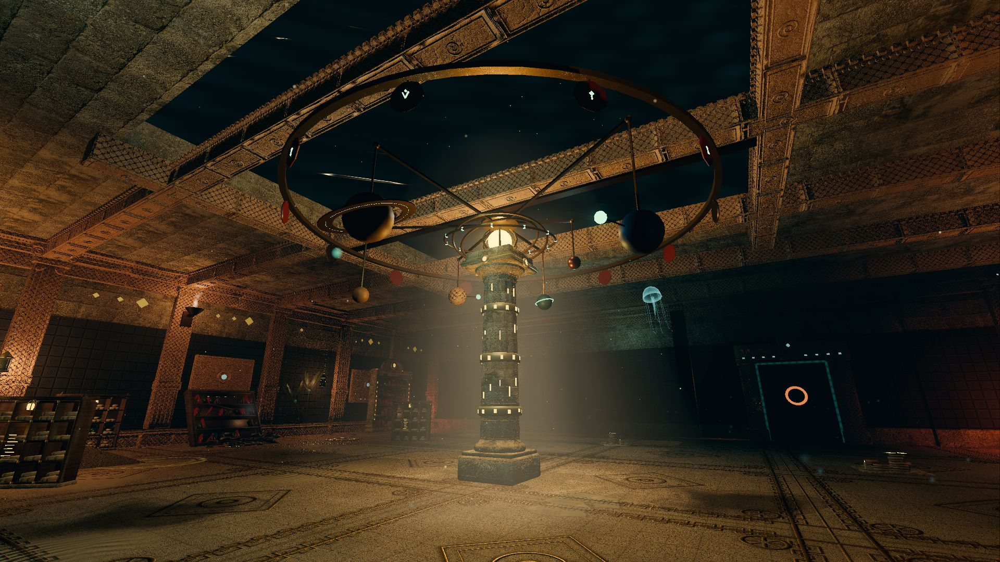</a></td>
    <td><a href="media/neu_bohrstation_getriebe.jpg">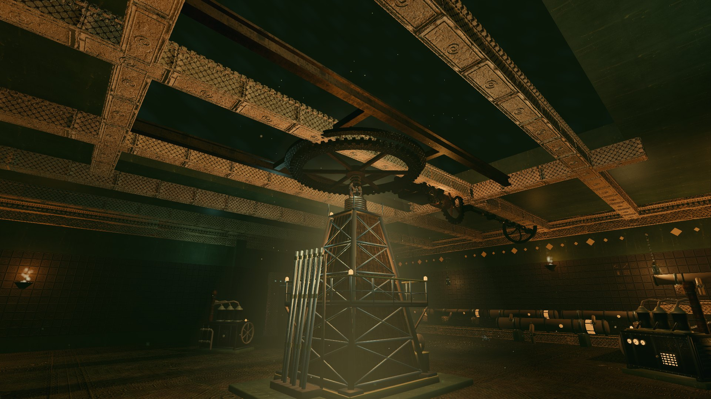</a></td>
  </tr>
  <tr>
    <td><a href="media/korallenkathedrale.jpg">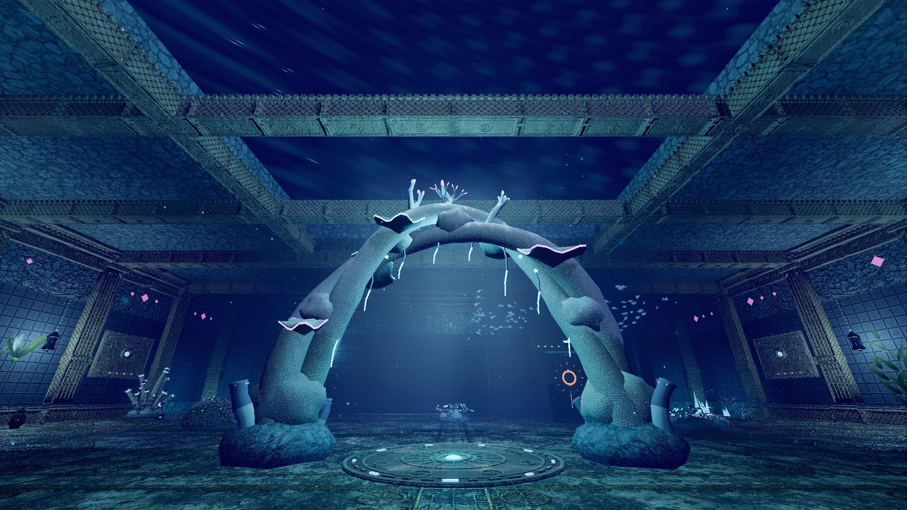</a></td>
    <td><a href="media/abgrund_portal.jpg">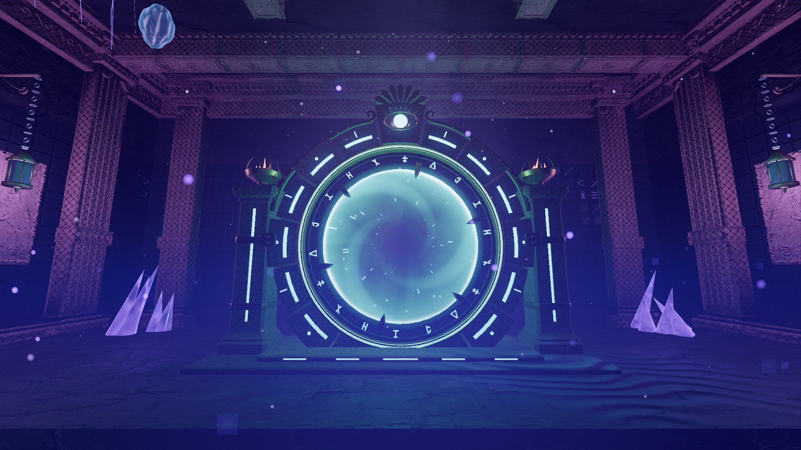</a></td>
  </tr>
  <tr>
    <td><a href="media/bosskampf_hud.jpg">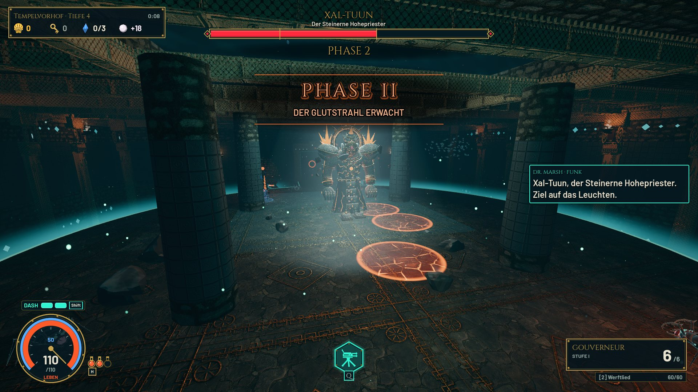</a></td>
    <td><a href="media/boss_bohrmutter.jpg">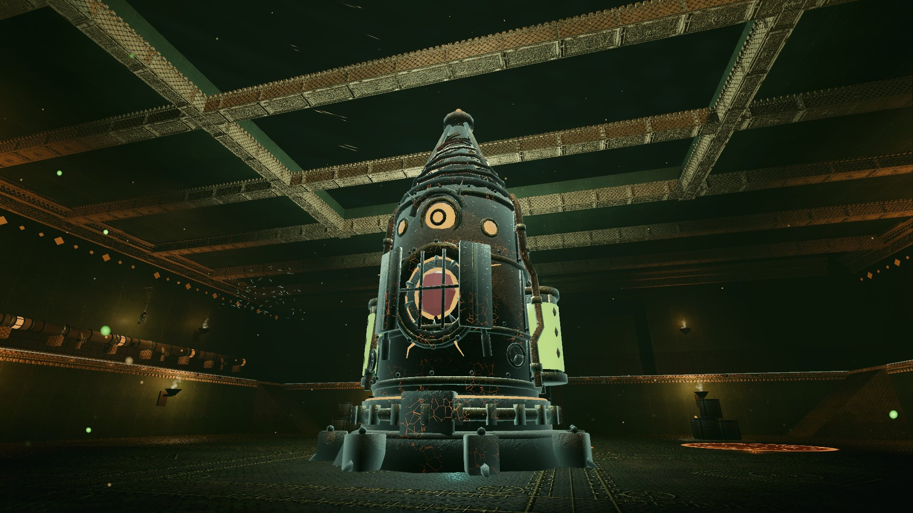</a></td>
  </tr>
  <tr>
    <td><a href="media/versunkene_archive.jpg">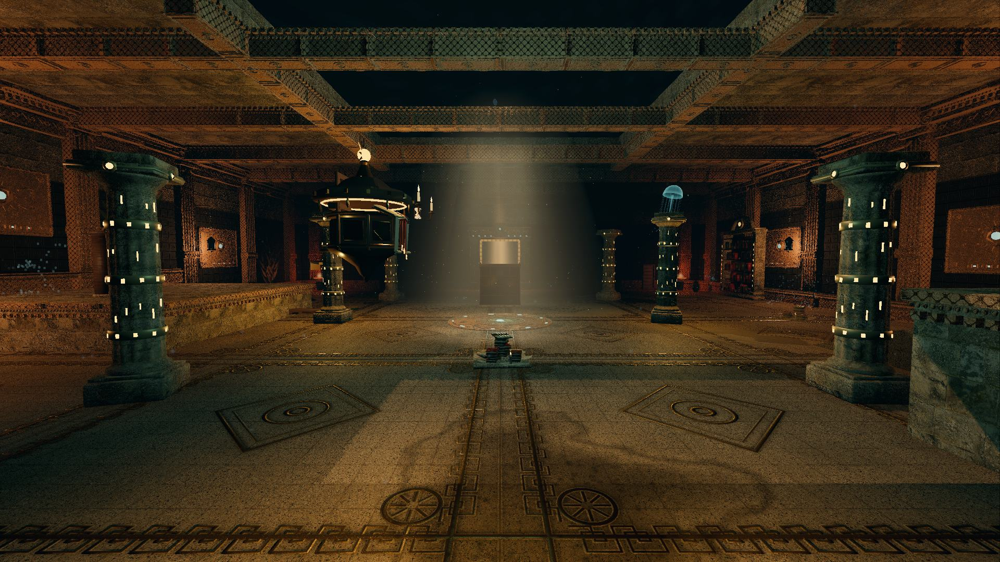</a></td>
    <td><a href="media/neu_uboot_bullauge.jpg">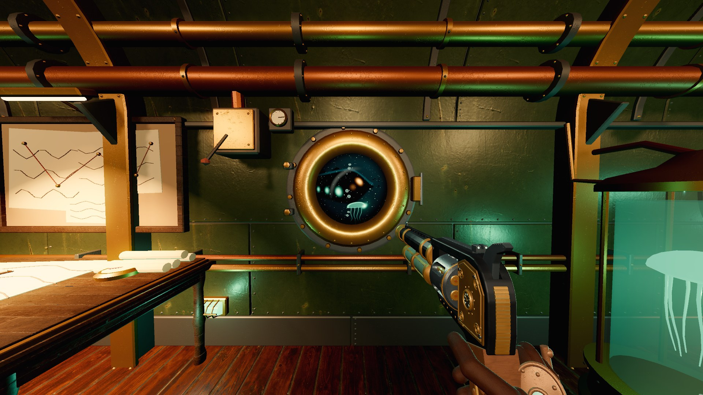</a></td>
  </tr>
  <tr>
    <td><a href="media/boss_archivar.jpg">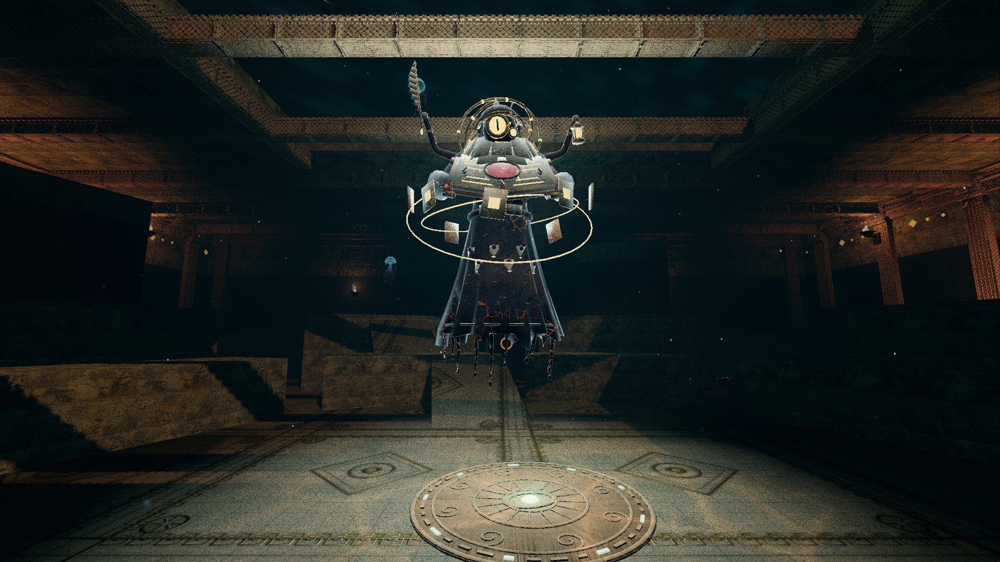</a></td>
    <td><a href="media/uboot_tauchkammer.jpg">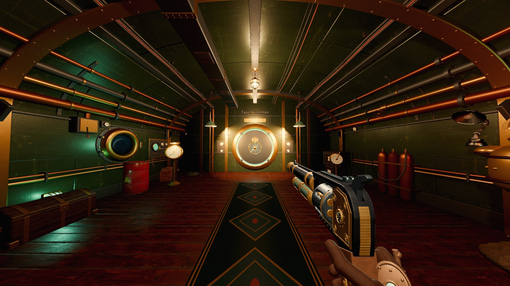</a></td>
  </tr>
  <tr>
    <td><a href="media/boss_xal_tuun.jpg">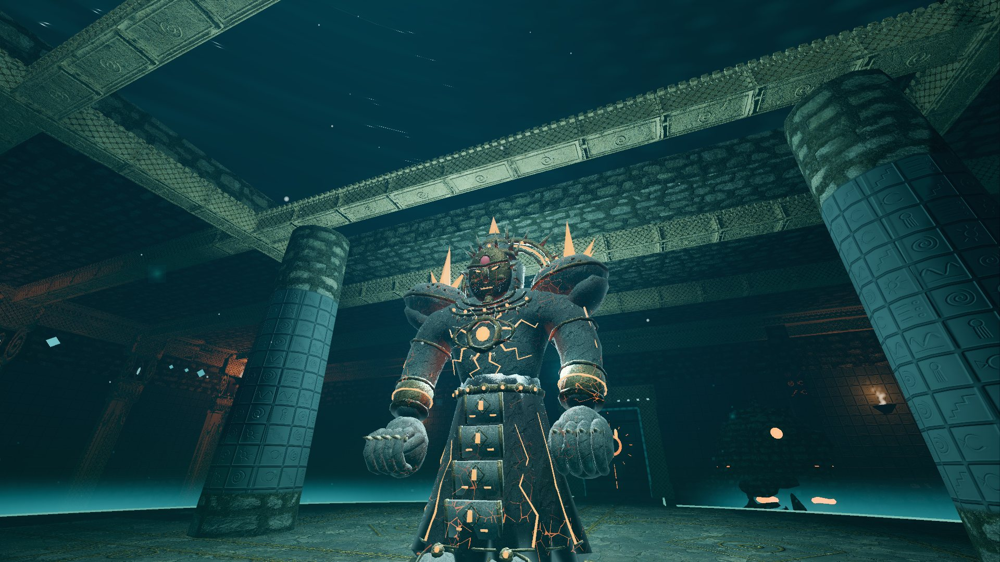</a></td>
    <td><a href="media/hauptmenue.jpg">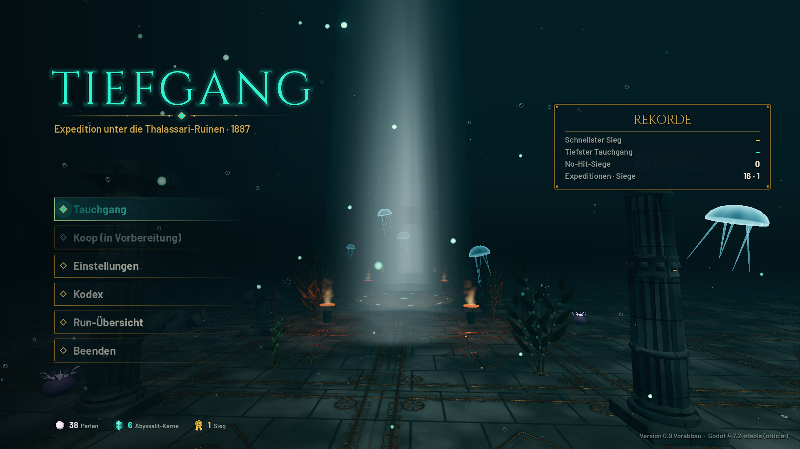</a></td>
  </tr>
</table>

Weitere Bilder auf der [Projektseite](https://osugerman.github.io/Tiefgang-Releases/). Alle Bilder sind echte Aufnahmen aus dem Test-Build.
More images on the [website](https://osugerman.github.io/Tiefgang-Releases/). Every image is a real capture from the test build.

## Credits

TIEFGANG wird mit der Godot Engine 4.7 entwickelt · TIEFGANG is built with the Godot Engine 4.7. Die vollständigen Namensnennungen liegen als **`CREDITS.md` im Release-Zip** bei · Full attributions are included as **`CREDITS.md` in the release zip**.

Fremd-Assets unter CC-BY-Lizenzen · Third-party assets under CC BY licences:

- Schmerzlaute · pain sounds: „11 male human pain/death sounds“ von · by **Michel Baradari**, [OpenGameArt](https://opengameart.org/content/11-male-human-paindeath-sounds) – [CC BY 3.0](https://creativecommons.org/licenses/by/3.0/), bearbeitet · edited (gekürzt, gefiltert, gemischt · trimmed, filtered, mixed).
- Schweißstrahl · welding beam: „WWS Welding“ von · by **Work With Sounds / Technical Museum of Slovenia**, [Wikimedia Commons](https://commons.wikimedia.org/wiki/File:WWS_Welding.ogg) – [CC BY 4.0](https://creativecommons.org/licenses/by/4.0/), bearbeitet · edited (Ausschnitte, gefiltert, gemischt · excerpts, filtered, mixed).
- Gesteinsmahlen · grinding stone: „WWS Quern-stones“ von · by **Work With Sounds / Museum of Municipal Engineering**, [Wikimedia Commons](https://commons.wikimedia.org/wiki/File:WWS_Quern-stones.ogg) – [CC BY 4.0](https://creativecommons.org/licenses/by/4.0/), bearbeitet · edited (verlangsamt, gefiltert, gemischt · slowed, filtered, mixed).

Schriften · Fonts: Cinzel und Barlow (SIL Open Font License). Musik mit Instrumentenaufnahmen von · Music using instrument recordings by Sam Gossner / Versilian Studios (VSCO-2-CE, VCSL, CC0). Alle übrigen Fremd-Sounds sind CC0 · All other third-party sounds are CC0. Ein herzlicher Dank an alle, die ihre Arbeit frei teilen · Heartfelt thanks to everyone who shares their work freely.

Dieses Repository enthält nur die Test-Builds und die Projektseite, nicht den Quellcode. · This repository contains only the test builds and the website, not the source code.

