

  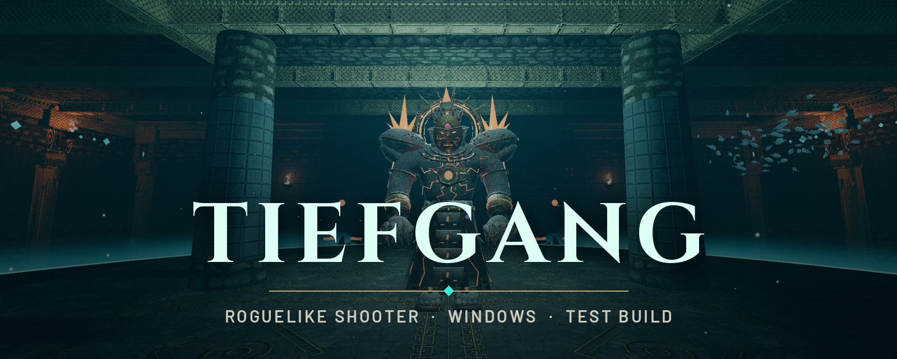

  <a href="https://github.com/OsuGerman/Tiefgang-Releases/releases/latest/download/Tiefgang-Windows.zip">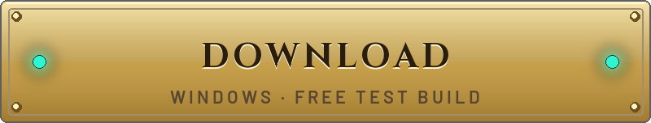</a>
  <a href="https://osugerman.itch.io/tiefgang">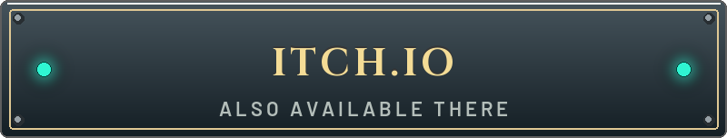</a>
  <a href="https://osugerman.github.io/Tiefgang-Releases/">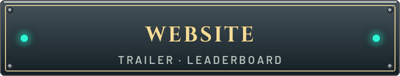</a>

  
  
   
  <b>English</b> · <a href="README.de.md">Deutsch</a> · <a href="CHANGELOG.md">Changelog</a> · <a href="KOOP.md">Co-op guide</a> 
  <a href="https://github.com/OsuGerman/Tiefgang-Releases">Star the repo</a> · <a href="https://github.com/OsuGerman/Tiefgang-Releases/discussions">Discussions</a> · <a href="https://github.com/OsuGerman/Tiefgang-Releases/milestones">Roadmap</a> · <a href="https://github.com/OsuGerman/Tiefgang-Releases/issues/new/choose">Report a bug</a>

**TIEFGANG** is a free **co-op roguelite FPS** set in 1887. Dive in a heavy brass diving suit, fight through drowned temples, sunken archives and ship wrecks, and build absurd combos from 9 weapons, 95 charms and elemental blessings. Play **solo or with 1–4 players in co-op**. Made with **Godot 4** by a solo developer, free test builds for **Windows** with automatic updates.

If you like **Roboquest**, **Gunfire Reborn** or **Risk of Rain 2**, this is that kind of run-based shooter, only deep underwater, in 1887, with something Lovecraftian waiting at the bottom.

⭐ <b>Like it? Star the repo</b> – it helps other players find TIEFGANG and keeps the updates coming.

> **RADIO · DR. A. MARSH · PACIFIC, 1887**
>
> *Tiefgang, Marsh here. Signal’s steady. Below you are the ruins of the Thalassari, the richest Abyssalite deposit anyone has ever found – and something that has been sleeping on top of it for a very long time. Go down, bring back what you can carry, and if you hear a heartbeat that isn’t yours: keep moving.*

  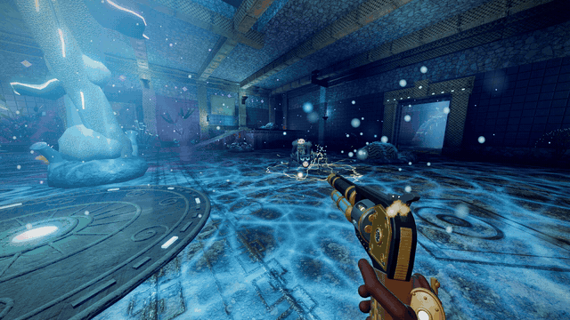
   <i>Void + Lightning = a black hole that swallows the room.</i>

<table><tr><td>
<b>New in the latest update</b> 
Co-op: see your teammates’ alt actions · no more flicker in treasure rooms · about 15 % more fps and far less shimmer · Report a Bug button · no more chests in walls.
<a href="CHANGELOG.md">Full changelog</a>
</td></tr></table>

1. **[Download Tiefgang-Windows.zip](https://github.com/OsuGerman/Tiefgang-Releases/releases/latest/download/Tiefgang-Windows.zip)** – or grab it on **[itch.io](https://osugerman.itch.io/tiefgang)**. Older builds live under [Releases](https://github.com/OsuGerman/Tiefgang-Releases/releases).
2. Extract the `Tiefgang` folder somewhere you can write to (Desktop, Documents). Not into `C:\Program Files`, or the auto-update can’t do its job.
3. Run `Tiefgang.exe`. Windows will probably say “Windows protected your PC” – **More info → Run anyway**. The test build isn’t signed.

New builds download themselves in the background and install only in the main menu, when you quit or at the next start – never mid-run. Your saves stay. No internet? The game starts anyway.

<b>System requirements and controls</b>

| | Minimum | Recommended |
|---|---|---|
| OS | Windows 10, 64-bit | Windows 10/11, 64-bit |
| Graphics | Vulkan-capable, 4 GB VRAM | Current mid-range, 8 GB VRAM |
| CPU | 4 cores | 6 cores or more |
| Memory | 8 GB | 16 GB |
| Storage | approx. 1 GB | approx. 1 GB |

Provisional – the game is still in development. Mouse and keyboard or controller, English and German.

| Action | Key |
|---|---|
| Move / aim | `W` `A` `S` `D` / mouse |
| Fire / alt-fire | left / right mouse button |
| Jump / dash | `Space` / `Shift` |
| Ability / melee | `Q` / `V` |
| Heal / use / reload | `H` / `E` / `R` |
| Switch weapon | `1` `2` or mouse wheel |
| Inspect weapon / charms | `F` / `Tab` |
| Pause | `Esc` |

Every key can be rebound in the settings.

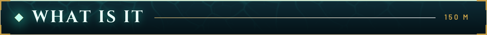

A fast first-person shooter built on roguelike runs. You descend through **14 depths** of combat rooms, treasure vaults, trials and boss arenas, picking up charms and blessings after every fight, until your build is either unstoppable or very, very funny. Standing still gets you killed; sprint, dash and double jump are your real armour. Between dives you go back to your submarine, research, gear up and go down again – one pressure level deeper.

It’s an indie project in active development. Things change fast, and a lot of what’s in here exists because testers complained about something. Latest round: co-op for up to four, three areas rebuilt to a new graphics standard, redone element effects, 25 new enemy attacks and a mechanic of its own for every weapon. Everything else is in the **[changelog](CHANGELOG.md)**.

<!-- TRAILER -->

  <a href="https://osugerman.github.io/Tiefgang-Releases/#trailer">
    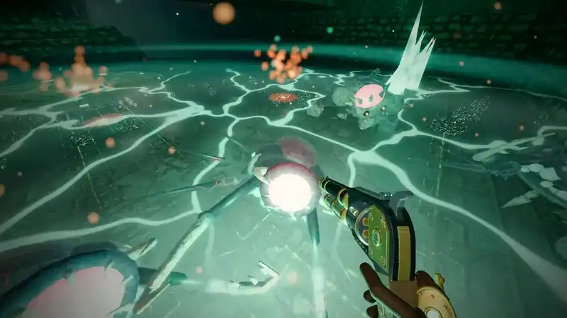
  </a>
   
  <a href="https://osugerman.github.io/Tiefgang-Releases/#trailer"><b>▶ Watch the cinematic trailer (2:21)</b></a>
  · <a href="docs/media/tiefgang_trailer.mp4">MP4 1080p</a> · <a href="https://github.com/OsuGerman/Tiefgang-Releases/releases/download/v2026.10.13.2110-18d62a60/TIEFGANG_Cinematic_Trailer_4K60.mp4">4K</a>

<!-- /TRAILER -->

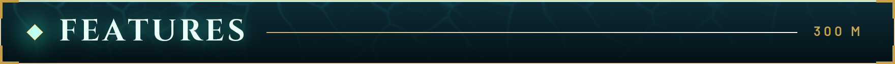

<table>
  <tr>
    <td width="50%" align="center">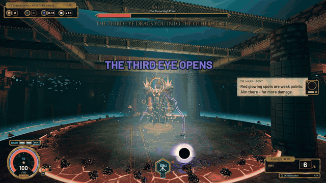 <b>Bosses with signature attacks</b> Xal-Tuun's third eye pulls your whole team into his otherworld.</td>
    <td width="50%" align="center">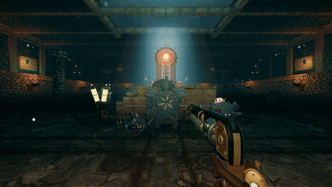 <b>Elemental reactions</b> Tide, Blood, Lightning and Void combine into chain reactions.</td>
  </tr>
  <tr>
    <td align="center">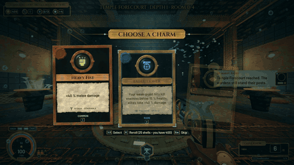 <b>Builds that shouldn't work</b> 95 charms and 36 blessings, picked from riveted reward cards.</td>
    <td align="center">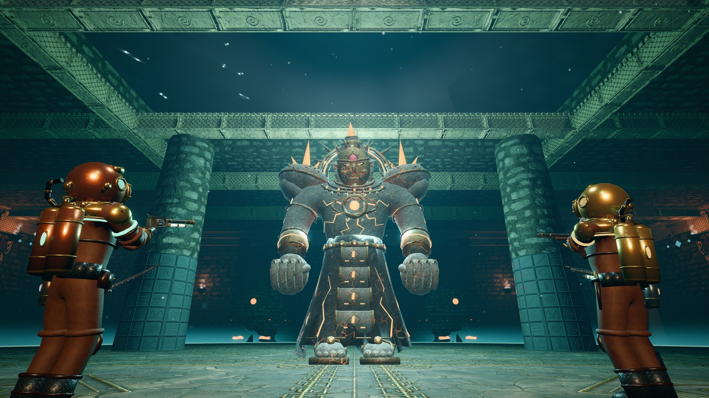 <b>Co-op for 1–4 divers</b> Room codes, personal loot, revive your crew.</td>
  </tr>
</table>

<table>
  <tr>
    <td width="50%"><b>5 areas, 14 depths</b> Temple Forecourt or Drilling Station, then the Coral Cathedral, the Sunken Archives and the Abyss.</td>
    <td width="50%"><b>5 bosses, 4 Heralds</b> Xal-Tuun, the Drill Mother, Ysmera, the Archivist, the Sleeper’s Ear – phases, weak points, their own music.</td>
  </tr>
  <tr>
    <td><b>9 weapons, 6 abilities</b> Every gun has an alt-fire, an active reload and a trick of its own. The Whaler reels enemies in on barbs.</td>
    <td><b>95 charms, 36 blessings + 6 Duo</b> Tide, Blood, Lightning and Void with reactions. If your build feels illegal, you’re doing it right.</td>
  </tr>
  <tr>
    <td><b>10 pressure levels</b> Beat the Abyss, turn the manometer up. Plus a Daily Run and Biome Choice.</td>
    <td><b>Dr. Marsh on the radio</b> 200+ radio lines, 72 codex entries and a bestiary page for everything that wants to eat you.</td>
  </tr>
</table>

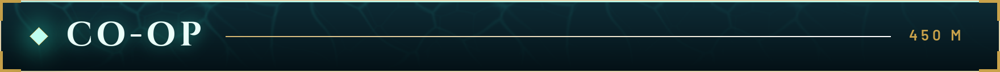

Up to **four divers**. One hosts, the others type in a room code – over the internet that usually works without port forwarding, and on a home network there’s a LAN code too. Everyone picks their own charms and blessings, shells are shared, and whoever goes down can be revived. Step by step: **[KOOP.md](KOOP.md)**.

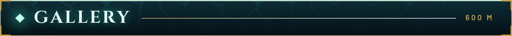

<table>
  <tr>
    <td width="33%"><a href="media/great_hall_leviathan.jpg">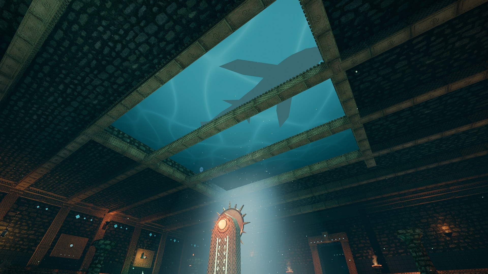</a></td>
    <td width="33%"><a href="media/fx_black_hole.jpg">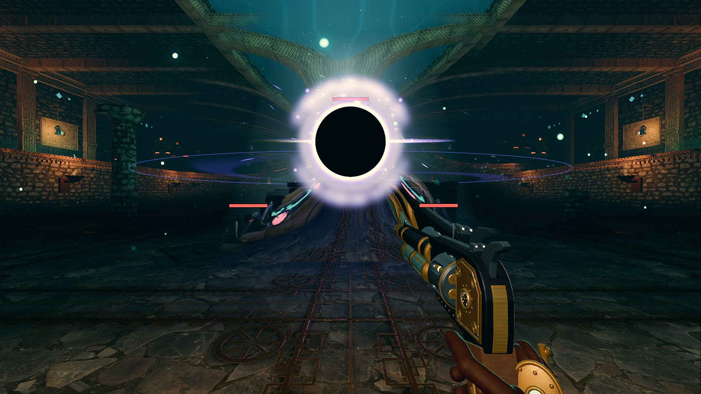</a></td>
    <td width="33%"><a href="media/coral_cathedral.jpg">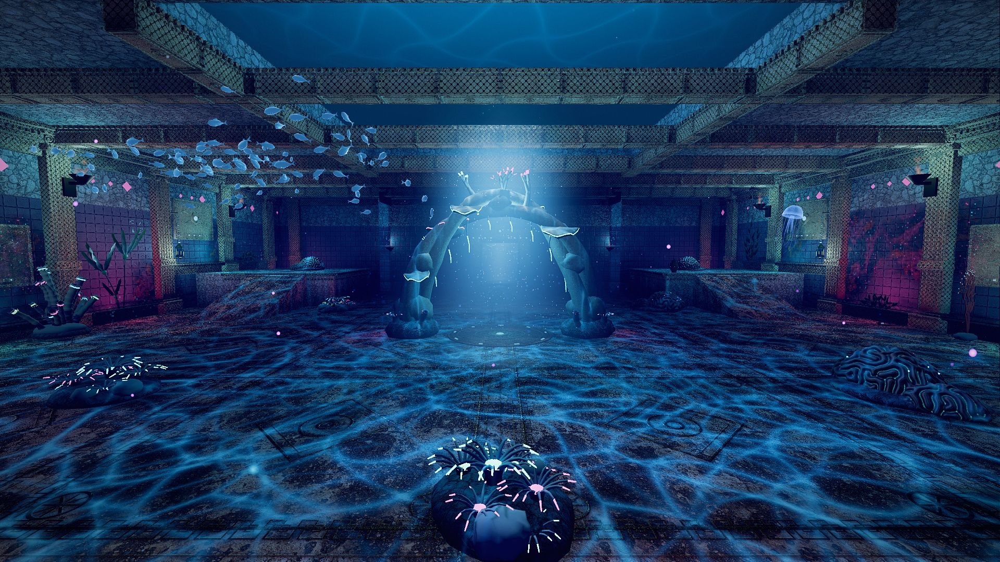</a></td>
  </tr>
  <tr>
    <td><a href="media/boss_xal_tuun_phase2.jpg">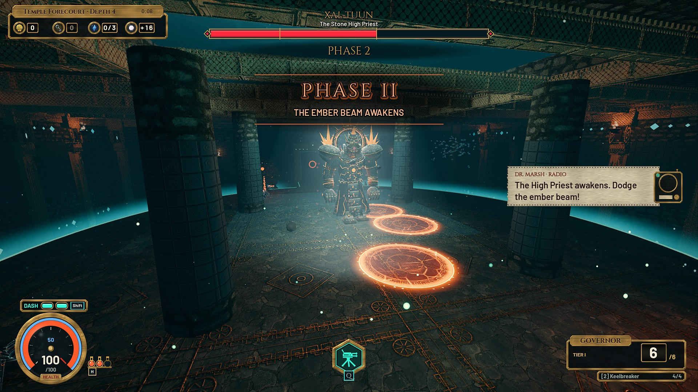</a></td>
    <td></td>
    <td><a href="media/boss_ysmera_phase2.jpg">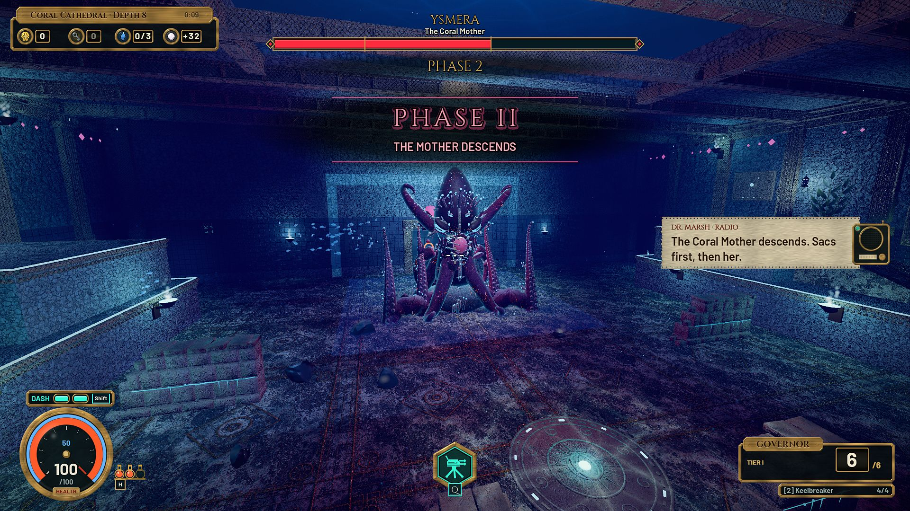</a></td>
  </tr>
  <tr>
    <td><a href="media/archives_reading_room.jpg">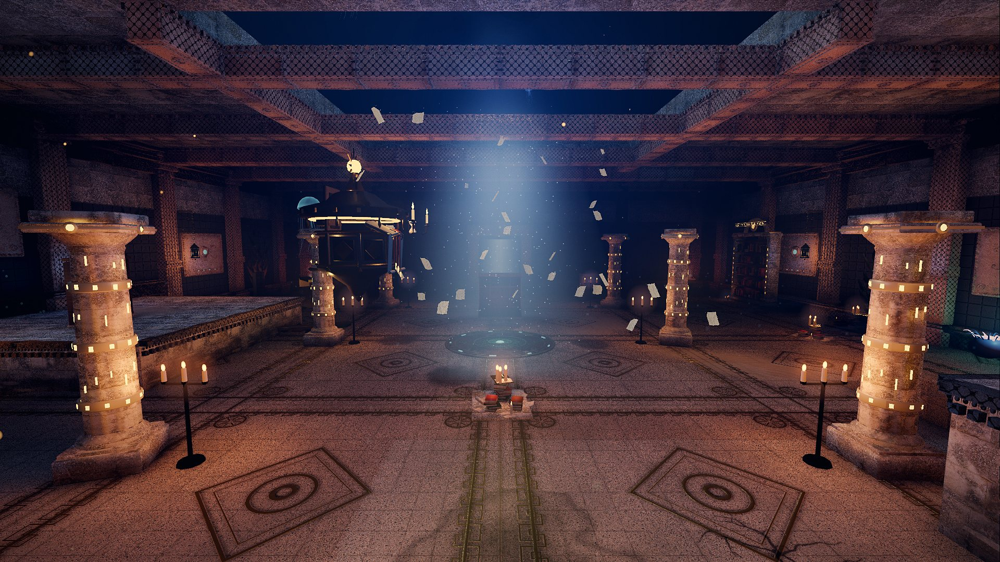</a></td>
    <td><a href="media/attack_reef_cage.jpg">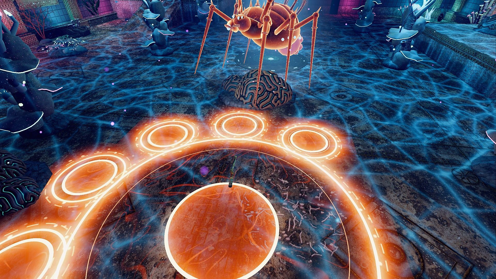</a></td>
    <td><a href="media/hud_combat.jpg">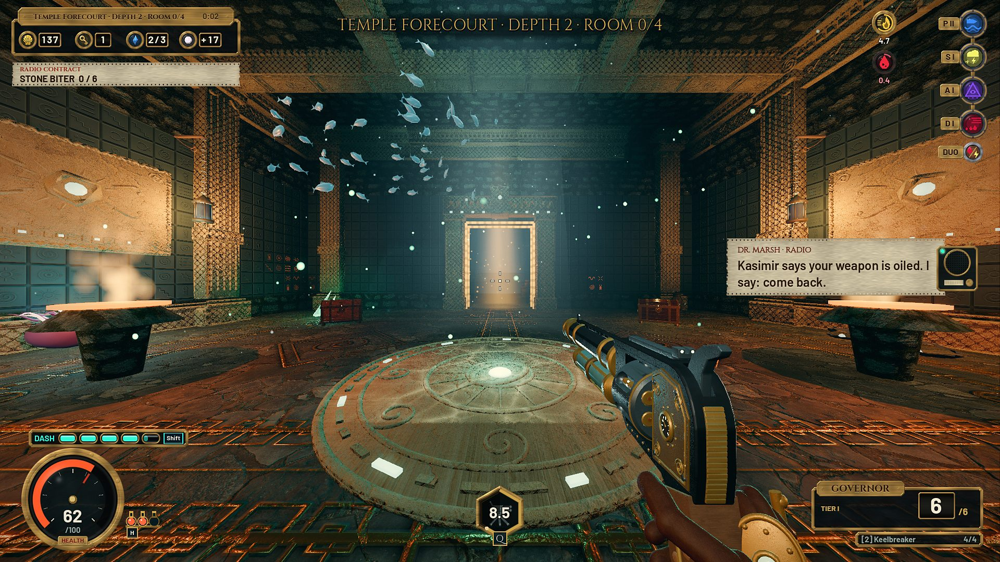</a></td>
  </tr>
</table>

All real captures from the test build. More on the **[website](https://osugerman.github.io/Tiefgang-Releases/)**.

## FAQ

**Is TIEFGANG free?** Yes, completely. No account, no launcher, no ads, no microtransactions. [Download the zip](https://github.com/OsuGerman/Tiefgang-Releases/releases/latest/download/Tiefgang-Windows.zip), extract it and play.

**What games is it like?** A fast first-person roguelite in the spirit of Roboquest and Gunfire Reborn, with the build-crafting of Risk of Rain 2 and Hades: fight a room, pick a reward, go deeper, beat the boss of each area. The setting is a steampunk deep-sea expedition in 1887.

**Can I play solo or offline?** Yes. Solo runs fully offline. Co-op for up to 4 players works over the internet with a room code, usually without port forwarding, or over LAN. See the [co-op guide](KOOP.md).

**What PC do I need?** Windows 10 or 11 (64-bit) and a Vulkan-capable GPU with 4 GB VRAM. Details under *System requirements and controls* above.

**Is it safe? Windows shows a warning.** The test build isn't code-signed yet, so SmartScreen warns about an unknown publisher. Click *More info → Run anyway*. The auto-updater only installs builds from this repository.

**Can I stream it or make videos?** Yes, monetized too. Just link [itch.io/tiefgang](https://osugerman.itch.io/tiefgang). Logo, cover and screenshots are in the [press kit](https://osugerman.github.io/Tiefgang-Releases/presskit/).

**Which languages?** English and German, switchable in the settings.

⭐ If you enjoyed TIEFGANG, <b><a href="https://github.com/OsuGerman/Tiefgang-Releases">star this repo</a></b> and share it with a friend you want to dive with.

Found a bug, hit a crash, or think the dash feels mushy? **[Open an issue](https://github.com/OsuGerman/Tiefgang-Releases/issues/new/choose)** – English or German. The version number (bottom right of the main menu), area, depth and a screenshot help a lot. Honest feedback has rebuilt parts of this game more than once.

Built with the Godot Engine 4.7. Full attributions ship as `CREDITS.md` in the release zip.

- Pain sounds: “11 male human pain/death sounds” by **Michel Baradari**, [OpenGameArt](https://opengameart.org/content/11-male-human-paindeath-sounds) – [CC BY 3.0](https://creativecommons.org/licenses/by/3.0/), edited.
- Welding beam: “WWS Welding” by **Work With Sounds / Technical Museum of Slovenia**, [Wikimedia Commons](https://commons.wikimedia.org/wiki/File:WWS_Welding.ogg) – [CC BY 4.0](https://creativecommons.org/licenses/by/4.0/), edited.
- Grinding stone: “WWS Quern-stones” by **Work With Sounds / Museum of Municipal Engineering**, [Wikimedia Commons](https://commons.wikimedia.org/wiki/File:WWS_Quern-stones.ogg) – [CC BY 4.0](https://creativecommons.org/licenses/by/4.0/), edited.
- Trailer music: “Devastation and Revenge” by **Kevin MacLeod**, [incompetech.com](https://incompetech.com) – [CC BY 4.0](https://creativecommons.org/licenses/by/4.0/).

Fonts Cinzel and Barlow (SIL Open Font License). Music using instrument recordings by Sam Gossner / Versilian Studios (VSCO-2-CE, VCSL, CC0). All other third-party sounds are CC0. Thanks to everyone who shares their work freely.

This repository holds the test builds and the website, not the source code.

Keywords: free roguelite FPS, roguelike shooter, co-op shooter, games like Roboquest, games like Gunfire Reborn, underwater game, deep sea, steampunk, Lovecraftian, indie game, Godot 4, Windows · kostenloser Roguelite-Shooter, Koop-Shooter
